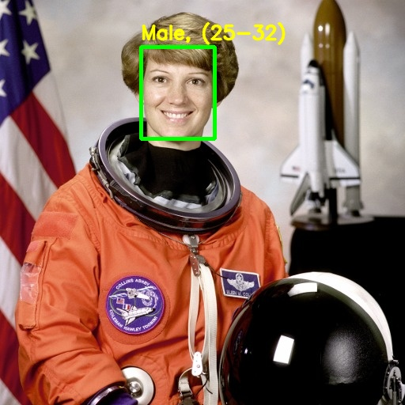

# Gender and Age Detection

Detects faces in an image or webcam stream and estimates each person's gender and age range using pretrained deep-learning models run through OpenCV's DNN module.

This repository builds on an existing MIT-licensed implementation (see [LICENSE](LICENSE)). The detection approach and pretrained models come from that work; the changes below are what this version adds.

## What this version changes

- **Works on current installs.** OpenCV 5 removed the Caffe importer that the age and gender models need, so the original script fails on a fresh `pip install opencv-python`. Dependencies are now pinned to OpenCV 4.x in `requirements.txt`.
- **Reusable structure.** `detect.py` is split into `load_models`, `detect_faces`, `predict` and `annotate`, so the pipeline can be imported and tested instead of only run as a script.
- **Headless and scriptable CLI.** New `--output`, `--no-display`, `--camera` and `--confidence` options. Images can be processed on a server with no display, and the annotated result saved to disk.
- **Confidence scores.** Each prediction reports the model's confidence for the gender and the age bucket.
- **Robustness.** Model paths resolve relative to the script, so it runs from any directory. Missing model files and unreadable images produce clear errors and a non-zero exit code. Face boxes are clipped to the frame, and the webcam loop quits cleanly on `q` or `Esc`.
- **Verified model downloads.** `download_models.py` fetches the large weight files from their original sources and verifies their SHA-256 checksums, so they don't need to live in git.
- **Tests.** A pytest suite covers model loading, empty images, predictions on sample images, the CLI and the download script.

## How it works

1. **Face detection:** an SSD face detector (TensorFlow `opencv_face_detector_uint8.pb`) finds faces above a confidence threshold (default 0.7).
2. **Preprocessing:** each face is cropped with 20 px padding and resized to 227x227 with mean subtraction.
3. **Classification:** two Caffe CNNs trained on the Adience benchmark predict:
   - gender: `Male` or `Female`
   - age bucket: `0-2`, `4-6`, `8-12`, `15-20`, `25-32`, `38-43`, `48-53`, `60-100`

Age is treated as classification over buckets rather than regression, because exact age is hard to estimate from a single photo (lighting, pose, makeup, expression).

## Project structure

```
detect.py                     # pipeline + CLI
download_models.py            # fetches and verifies the model weights
requirements.txt              # runtime dependencies (OpenCV 4.x)
requirements-dev.txt          # adds pytest
tests/                        # pytest suite
opencv_face_detector.pbtxt    # face detector config
opencv_face_detector_uint8.pb # face detector weights (downloaded)
age_deploy.prototxt           # age model config
age_net.caffemodel            # age model weights, ~45 MB (downloaded)
gender_deploy.prototxt        # gender model config
gender_net.caffemodel         # gender model weights, ~45 MB (downloaded)
samples/                      # public-domain sample image + SOURCES.md
examples/                     # annotated output generated by detect.py
```

## Setup

Requires Python 3.8+.

```bash
python -m venv .venv
source .venv/bin/activate        # Windows: .venv\Scripts\activate
pip install -r requirements.txt
python download_models.py        # fetch and verify the model weights (~93 MB)
```

`download_models.py` downloads the three weight files from their original sources (the authors' release for the age and gender models, OpenCV's model repository for the face detector), checks each one against a pinned SHA-256 checksum, and skips files that are already present and valid. A failed or corrupted download never replaces a good file. Use `--force` to re-download, or `--dest DIR` to save elsewhere.

## Usage

Analyze an image and show the result in a window:

```bash
python detect.py --image samples/astronaut.jpg
```

Run headless and save the annotated image:

```bash
python detect.py --image samples/astronaut.jpg --no-display --output result.jpg
```

Example output:

```
Gender: Male (100%)
Age: 25-32 years (99%)
Saved annotated image to result.jpg
```



The prediction is wrong: the photo shows astronaut Eileen Collins, a woman. It is kept as the example on purpose, because it shows the kind of error these models make (see [Limitations](#limitations)).

Use the webcam (press `q` or `Esc` to quit):

```bash
python detect.py                 # default camera
python detect.py --camera 1      # another camera
```

All options:

| Option | Description |
|---|---|
| `--image PATH` | Image to analyze; omit to use the webcam |
| `--output PATH` | Save the annotated image (image mode) |
| `--no-display` | Don't open a window (image mode) |
| `--camera N` | Webcam index, default `0` |
| `--confidence X` | Minimum face detection confidence, default `0.7` |

Use it as a library:

```python
import cv2
import detect

models = detect.load_models()
frame = cv2.imread("samples/astronaut.jpg")
for p in detect.predict(models, frame):
    print(p.box, p.gender, p.age, f"{p.age_confidence:.0%}")
```

## Tests

```bash
pip install -r requirements-dev.txt
python -m pytest tests
```

## Limitations

- The models were trained on Adience, a dataset of Flickr photos with limited demographic balance. Accuracy varies across age groups, skin tones and image conditions, and predictions should not be used for decisions about real people.
- Gender is predicted as a binary label, which does not reflect gender identity. Confidence scores are not calibrated: the sample image is misclassified as `Male` with 100% confidence.
- Age buckets have gaps (for example 13-14 or 33-37), so people in those ranges are assigned to a neighbouring bucket.
- Small, blurred, occluded or strongly turned faces may not be detected.

## License

MIT. See [LICENSE](LICENSE). The pretrained age and gender models come from Gil Levi and Tal Hassner's Adience research release and are subject to their own terms. The sample image is a public-domain NASA photo; see [samples/SOURCES.md](samples/SOURCES.md).
